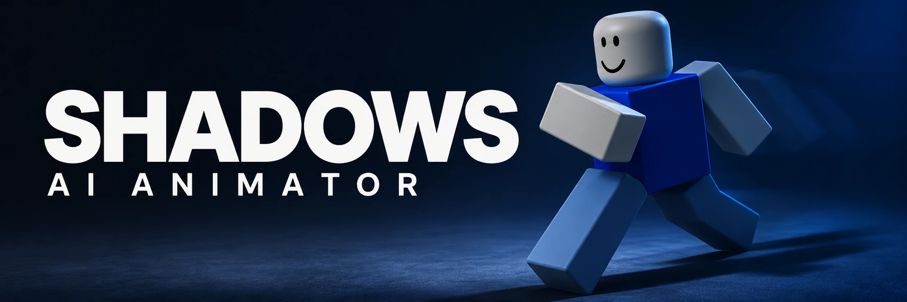
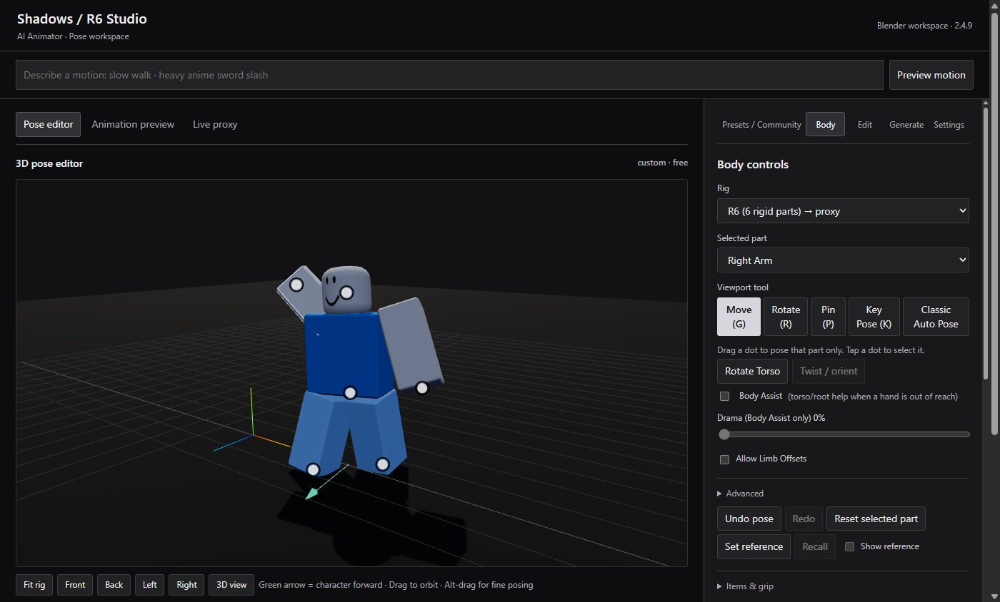
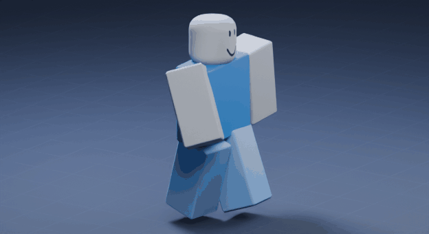

  

Animate Roblox R6 and R15 characters in Blender. Start with a prompt or a hand-posed keyframe, then refine the motion in Shadows.

  

  <a href="guide/quickstart.md">Illustrated setup guide</a>
  &nbsp; · &nbsp; <a href="https://github.com/Juanvpizza/Shadows-AI-Animator/releases/latest">Latest release</a>

Version 2.4.9 &nbsp; · &nbsp; 64-bit Windows &nbsp; · &nbsp; Blender 5.2

## Inside the pose editor

Drag a hand into position, pin a support foot, and add the pose as a keyframe. Switch to Animation preview to play the movement between your keys.

| If you want to… | In Shadows |
| --- | --- |
| Start an animation from a prompt | Open **Generate**, describe the action, then play the preview before applying it. |
| Refine one section | Select the action, tracks, and frame range in **Edit**. Preview the change with **Edit Chat** or adjust **Limb Speed**. |
| Bring a held item into Roblox Studio | Lock its fit on your R6, choose **Export equipped item**, then use **Attach item** on the animated Roblox rig. |

## Play the starter Walk

Open **R6 Starter.blend** from the download and press Play in Blender. This preview uses the **Walk** action included with the rig.

## Get started

Extract the Windows download, open **Start Here.html**, and install the inner **Shadows Studio.zip** in Blender. The guide also covers exporting an animation and attaching a prop to a stock Roblox R6. [Follow the setup guide on GitHub →](guide/quickstart.md)
