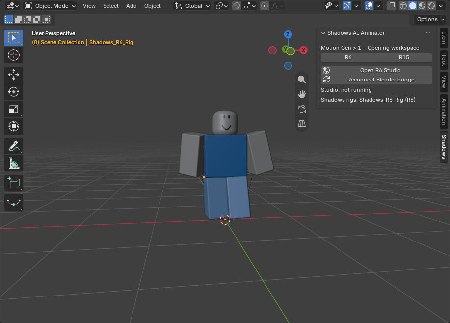
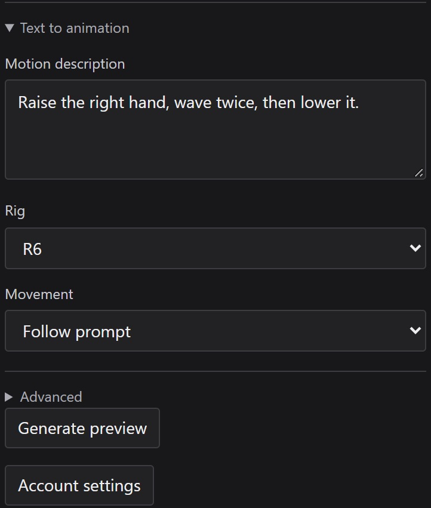
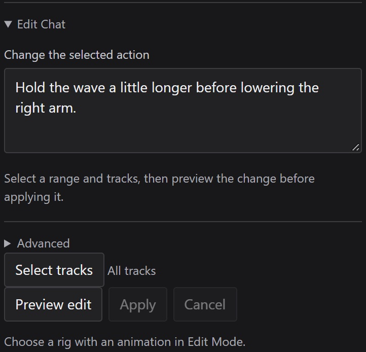

# Set up Shadows AI Animator

You'll need 64-bit Windows and Blender 5.2. The Windows ZIP includes the Blender add-on, an animated R6 starter rig, and an optional Roblox Studio plugin. [Download the latest release](https://github.com/Juanvpizza/Shadows-AI-Animator/releases/latest).

## Install the Blender add-on

1. Extract the Windows download. Inside, leave **Shadows Studio.zip** zipped.
2. In Blender, open **Edit → Preferences → Add-ons**. Use the menu at the upper right to choose **Install from Disk…** and select **Shadows Studio.zip**. Enable **Shadows AI Animator**.
3. Save your current scene, then open **R6 Starter.blend** from the extracted folder. Play the included **Walk** action to see the rig move.
4. With the pointer over Blender’s 3D viewport, press **N**. In the **Shadows** sidebar, click **Open R6 Studio**. Keep Blender open while you work in the browser.

## Make a wave

In Shadows, choose **Generate → Text to animation**. Connect a supported account in **Settings** if prompted. Try *“Raise the right hand, wave twice, then lower it.”* Generate a preview, play it, and apply it to create a Blender action.

To change the wave, select the action in **Edit**, open **Edit Chat**, and try *“Hold the wave a little longer before lowering the right arm.”* Preview the edit before choosing **Apply** or **Cancel**.

## Bring it into Roblox Studio

1. For a stock R6 character, open **Animation preview → Export R6 animation** in Shadows. This downloads a `.rbxmx` animation.
2. In Roblox Studio, open the Animation Editor on the destination R6. In Explorer, expand **ServerStorage → RBX_ANIMSAVES**, right-click the folder for that rig and choose **Insert from File…**. Select the downloaded animation. Older rigs may keep this folder under the rig itself as **AnimSaves**.
3. In the Animation Editor, choose **⋯ → Load**, select the clip by name, and press **Play**.

**If your R6 is holding an item**

1. Once per computer, open **Plugins → Plugins Folder** in Roblox Studio, copy **Shadows Grip.rbxmx** from the Windows download into that folder, and restart Studio.
2. In Shadows, open **Body → Items & grip**, equip the item, adjust it in the hand, and choose **Lock fit**. Click **Export equipped item** to download its `.glb`.
3. In Roblox Studio, use **File → Import** on the GLB and leave all five meshes selected. Select the animated **R6** under **Workspace** and click **Plugins → Shadows → Attach item**. Scrub the animation to see it follow the right hand.

[Back to the project](../README.md)
